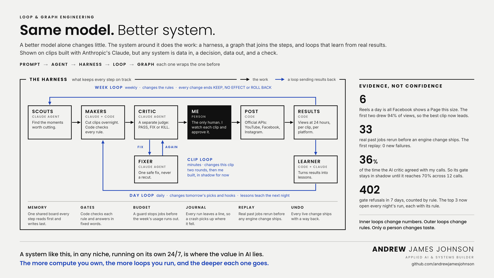

# Loop Engineering

**Same model. Better system.**

A better model alone changes little. The system around it does the work: a harness that keeps every step on track, a graph that joins the steps, and loops that check the work and learn from real results.

I show it on [The Clip Factory](https://github.com/andrewjamesjohnson/clip-factory), the media operation I built and run on Anthropic's Claude. Clips are just the easiest to show. Any system is data in, a decision, data out, and a check.

**One page version:** [PDF](loop-engineering.pdf) · [PNG](loop-engineering.png)

## The chain

**Prompt → Agent → Harness → Loop → Graph.** Each one wraps the one before.

## The graph

Scouts → Makers → Critic → **Me** → Post → Results

| Step | Who | Job |
|---|---|---|
| Scouts | Claude agent | Find the moments worth cutting. |
| Makers | Claude + code | Cut clips overnight. Code checks every rule. |
| Critic | Claude agent | A separate judge: PASS, FIX or KILL. |
| **Me** | Person | The only human. I watch each clip and approve it. |
| Post | Code | Official APIs: YouTube, Facebook, Instagram. |
| Results | Code | Views at 24 hours, per clip, per platform. |

## The loops

| Loop | How often | What it changes |
|---|---|---|
| Clip loop | Minutes | This clip. The critic sends it to the fixer and checks again: two rounds, then me. Built, in shadow for now. |
| Day loop | Daily | Tomorrow's picks and hooks. The learner turns results into lessons that teach the next night. |
| Week loop | Weekly | The rules. Every change ends KEEP, NO EFFECT or ROLL BACK. |

> Inner loops change numbers. Outer loops change rules. Only a person changes taste.

## The harness

What keeps every step on track.

- **Memory:** one shared board every step reads first and writes last.
- **Gates:** code checks each rule and answers in fixed words.
- **Budget:** a guard stops jobs before the week's usage runs out.
- **Journal:** every run leaves a line, so a crash picks up where it fell.
- **Replay:** real past jobs rerun before any engine change ships.
- **Undo:** every live change ships with a way back.

## Seven parts of a loop

The clip loop, filled in.

1. **Start:** the critic says FIX.
2. **Goal:** the clip passes the critic.
3. **Memory:** the critic's notes and the clip's past calls.
4. **Allowed:** only the fixer's safe fixes, never a recut.
5. **Proof:** the critic checks again. A maker never grades itself.
6. **Feedback:** the critic's reason goes back to the fixer.
7. **Stop:** two rounds, then a person decides.

15 scheduled Claude jobs checked on all seven: 101 of 105 in place.

## Evidence, not confidence

Measured November 2026.

- **6** Reels a day is all Facebook shows a Page this size. The first two drew 94% of views, so the best clip now leads.
- **33** real past jobs rerun before an engine change ships. The first replay: 0 new failures.
- **36%** of the time the AI critic agreed with my calls. So its gate stays in shadow until it reaches 70% across 12 calls.
- **402** gate refusals in 7 days, counted by rule. The top 3 now open every night's run, each with its rule.

## The same loop fits any system

| | Data in → | Decision → | Data out → | Proof |
|---|---|---|---|---|
| Media | Streams, video, news | Which moment to cut | A posted clip | Views at 24 hours |
| Energy | Load, prices, weather | When to buy, store or run | A dispatch schedule | Real cost against forecast |
| Finance | Prices, filings, news | Which idea to test | A signal or a trade plan | Returns on data it never saw |
| Operations | Orders, tickets, invoices | What to route, flag or fix | An action or a report | Errors caught, time saved |
| **Any system** | **Whatever comes in** | **What to do with it** | **Whatever goes out** | **A check, never the agent's word** |

## Why it matters

**A system like this, in any niche, running on its own 24/7, is where the value in AI lies. The more compute you own, the more loops you run, and the deeper each one goes.**

My own logs show it. Today a weekly usage cap decides how many loops run, and when it ran out on 25 October a whole night of clips was lost. On local hardware the loops run day and night with no meter, and each decision can test 30 versions instead of one.

## How it's made

Plain HTML and CSS, no chart library. [`src/loop-engineering.html`](src/loop-engineering.html) is the one page. [`src/build_wide.py`](src/build_wide.py) lifts its graph into the 16:9 card, so the two never drift apart. [`src/render.sh`](src/render.sh) prints both with headless Chrome.

---

© 2026 Andrew James Johnson. All rights reserved. Shared as a portfolio piece.
